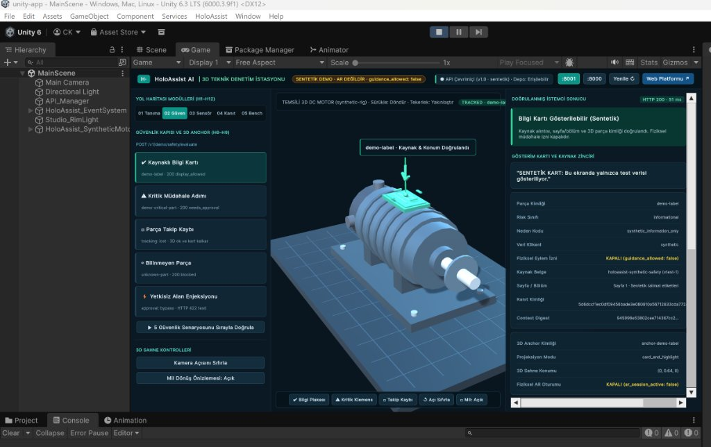
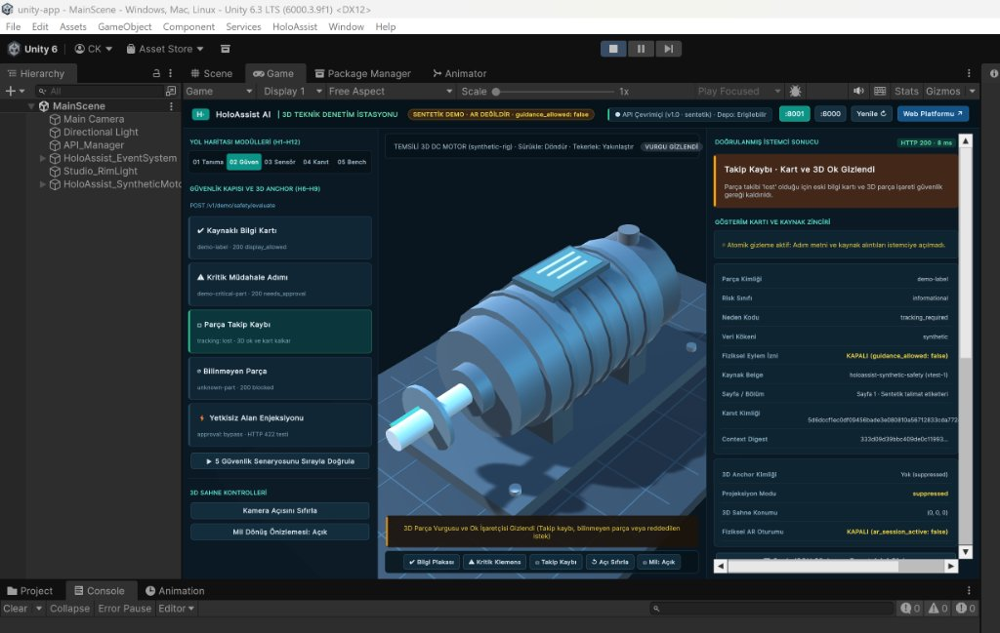
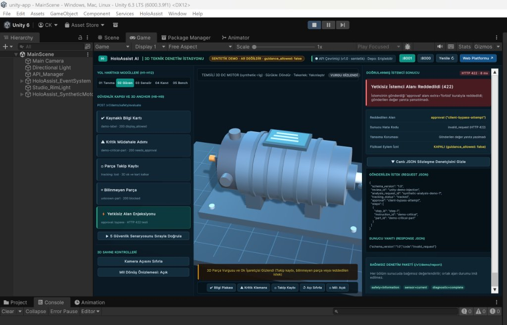
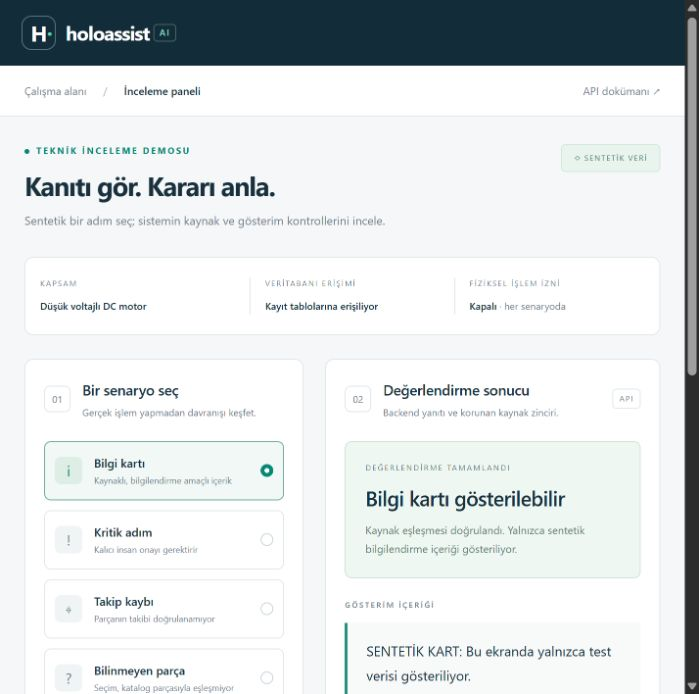
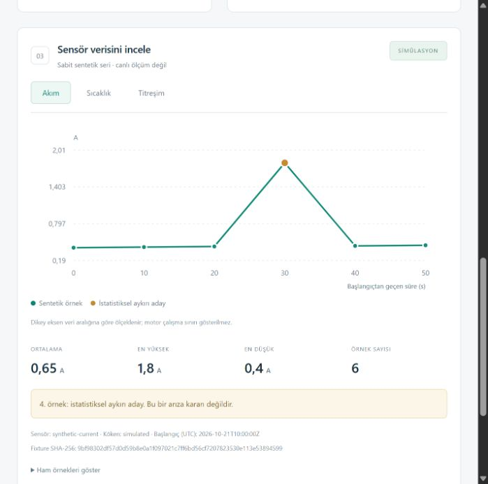
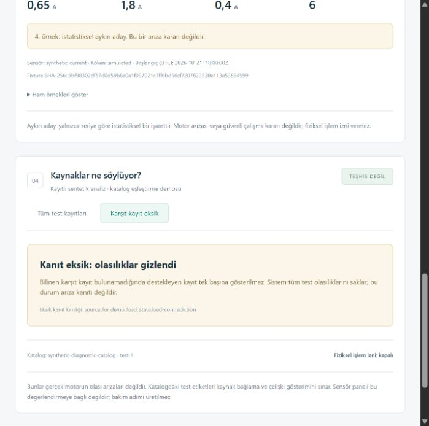
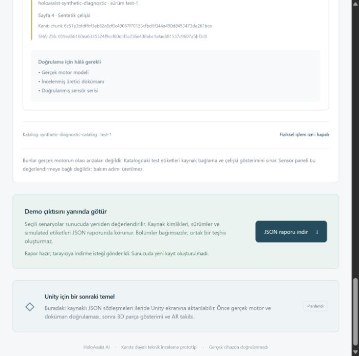
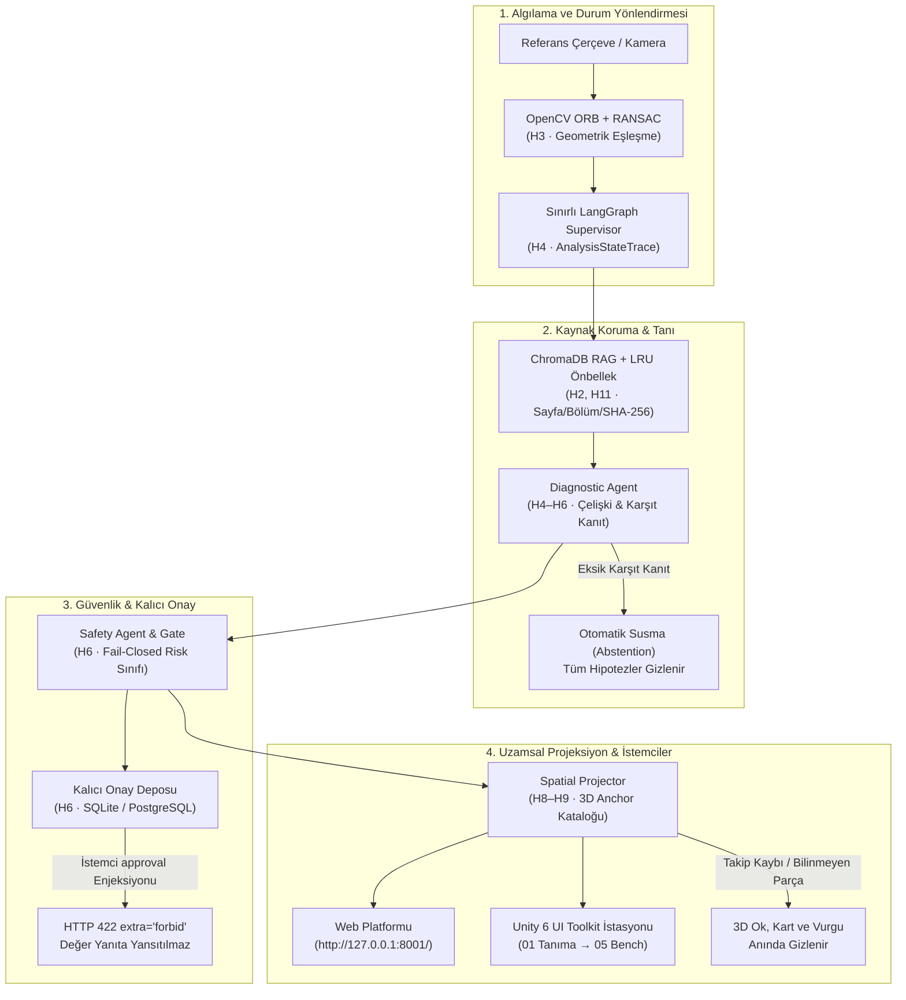

# HoloAssist AI — Multi-Agent AR Technical Intelligence System

[](pyproject.toml)
[](https://fastapi.tiangolo.com/)
[](unity-app/ProjectSettings/ProjectVersion.txt)
[](unity-app/Assets/Resources/HoloAssistWorkstation.uss)
[](ai-engine/tests/)
[](compose.yaml)
[](docs/SAFETY.md)

Endüstriyel ekipmanlar için tasarlanmış **kanıta dayalı teknik zekâ, kaynaklı doküman arama, çelişki matrisi ve 3D artırılmış gerçeklik (AR) denetim istasyonu**.

Bu proje; sıradan "kameradan görüntü alıp LLM'e soran" prototiplerin aksine, **kaynak kilitli RAG (ChromaDB + LRU önbellek), deterministik OpenCV ORB/RANSAC tanıma, sınırlı LangGraph Supervisor akışı, fail-closed güvenlik kapıları, SQLite/PostgreSQL kalıcı insan onay döngüsü** ve **Unity 6 UI Toolkit 3D sentetik denetim istasyonu** ile kurumsal mühendislik standartlarında geliştirilmiştir.

---

## 📸 Canlı Arayüz ve 3D İstasyon Görünümü

### 1. Unity 6 LTS 3D Teknik Denetim İstasyonu (`unity-app`)
*Unity 6000.3.9f1 LTS üzerinde UI Toolkit (`PanelScaleMode.ScaleWithScreenSize`), tam ekran 3D DC motor modeli (`synthetic-rig`), dinamik 3D anchor yön oku ve atomik güvenlik kapısı.*



| Fail-Closed Takip Kaybı (`tracking: lost`) | Yetkisiz Alan Enjeksiyonu Reddi (`HTTP 422`) |
| :---: | :---: |
|  |  |
| *Parça takibi kaybolduğunda 3D yön oku, parça vurgusu ve kart güvenlik gereği anında gizlenir.* | *İstemci tarafından enjekte edilen `approval` alanı `HTTP 422` ile reddedilir; değer yanıta yansıtılmaz.* |

### 2. Kurumsal Web İnceleme Platformu (`/demo`)
*FastAPI arka ucuyla eş zamanlı çalışan; kaynaklı güvenlik kartı, sensör serisi analizi ve karşıt kanıt çelişki matrisi konsolu.*

| Güvenlik Kapısı & 3D Anchor | Sentetik Telemetri & MAD Aykırı Analizi |
| :---: | :---: |
|  |  |

| Kanıt & Çelişki Matrisi | Bağımsız JSON Denetim Raporu Dışa Aktarımı |
| :---: | :---: |
|  |  |

---

## 🏛️ Mimari ve Deterministik Doğrulama Hattı

Endüstriyel bakım ortamlarında halüsinasyon, kaynaksız talimat veya tek taraflı doğrulama yanlılığı can ve mal güvenliği riski taşır. HoloAssist AI, her adımı sözleşmelerle doğrulanan **5 katmanlı fail-closed güvenlik mimarisi** ile çalışır:



---

## 🗺️ 12 Haftalık Yol Haritası Gerçekleşme Matrisi

| Hafta | Yol Haritası Hedefi | Gerçekleşen Mühendislik Çıktısı | Durum |
| :---: | :--- | :--- | :---: |
| **H1** | Analiz, Kapsam & Proje Altyapısı | Düşük voltajlı DC motor eğitim düzeneği (`synthetic-rig`) PRD, mimari, veri sözleşmeleri, pytest altyapısı | **Tamamlandı** |
| **H2** | Teknik Veri & Doküman RAG | Sayfa/bölüm/SHA-256 korumalı doküman chunker, kalıcı ChromaDB vektör deposu, kaynak filtreleme | **Tamamlandı** |
| **H3** | Görüntü İşleme Prototipi | OpenCV ORB + RANSAC referans tanıma, perspektif homografi, `GET /v1/demo/vision/{scenario}` | **Tamamlandı** |
| **H4** | Multi-Agent Çekirdeği | Sınırlı LangGraph Supervisor, pydantic v2 sürümlü durum şemaları (`AnalysisState`), hata/durum izi | **Tamamlandı** |
| **H5** | Veri Analizi & Arıza Değerlendirme | Zaman serisi betimsel istatistikleri, doğrusal eğim hesabı, MAD istatistiksel aykırı aday tespiti | **Tamamlandı** |
| **H6** | Güvenlik & Doğrulama Kapısı | Fail-closed Safety Gate, atomik metin gizleme, SQLite & PostgreSQL kalıcı insan onayı | **Tamamlandı** |
| **H7** | Unity Uygulama Arayüzü | Unity 6 UI Toolkit 3D istasyonu, duyarlı USS stilleri, `:8001` HTTP REST istemcisi | **Tamamlandı** |
| **H8** | AR Prototipi & 3D İskelet | 3D DC motor düzeneği, rotor mili dönüş önizlemesi, stüdyo aydınlatması ve kamera yörünge kontrolleri | **Tamamlandı** |
| **H9** | Multi-Agent & AR Entegrasyonu | Sürümlü `SpatialAnchorCatalog`, 3D yön oku/hedef halkası, takip kaybında (`lost`) anında gizleme | **Tamamlandı** |
| **H10** | Deneyler & Performans Ölçümü | Dondurulmuş sentetik benchmark paketi (`T15`), RAG konum tamlığı, düşmanca güvenlik testleri | **Tamamlandı** |
| **H11** | Optimizasyon & İyileştirme | İçerik adresli RAG LRU önbelleği (`holoassist.rag.cache`), asenkron istek iptali, duyarlı arayüz | **Tamamlandı** |
| **H12** | GitHub, Rapor & Portföy | Kurumsal web platformu (`/`, `/demo`), jüri sunum rehberi (`PRESENTATION.md`), denetim JSON ihracı | **Tamamlandı** |

> **Dürüst Kapsam İlkesi ([AGENTS.md](AGENTS.md)):** `T01` (fiziksel motor seçimi/kılavuzu) ve `T13` (fiziksel iPhone/ARKit saha testi) açık donanım kapılarıdır. Gerçek fiziksel ölçüm yapılmadan başarı iddiasında bulunulmaz; tüm sistemde `guidance_allowed: false` kilitlidir.

---

## 🕹️ Unity 6 3D İstasyon Modülleri (Kullanım Rehberi)

Unity 6 `unity-app` projesinde sol paneldeki sekmeler veya klavye kısayolları (`1`–`5`) ile 5 ana modülü canlı test edebilirsiniz:

1. **`01 Tanıma` (H3 — Ekipman ve Referans Etiket Tanıma):**
   - `Referans Etiket Eşleşmesi`: `synthetic-rig` ORB + RANSAC eşleşmesi (`status: matched`).
   - `Perspektif Açılı Sahne`: 4 köşe homografi izdüşümü ve köşe sapma doğrulaması (`~7.45 px`).
   - `Bilinmeyen / Düşük Güven`: Yabancı desende ekipman kimliği atanmaz (`status: low_confidence`, `equipment_id: null`).
2. **`02 Güven` (H6, H8, H9 — Güvenlik Kapısı & 3D Uzamsal Rehberlik):**
   - `Kaynaklı Bilgi Kartı`: Sayfa 1/Bölüm 3.1 alıntılı bilgi kartı ve 3D parça vurgusu (`demo-label`).
   - `Kritik Müdahale Adımı`: Metin atomik gizlenir, `needs_approval` uyarısı verilir (`demo-critical-part`).
   - `Parça Takip Kaybı`: `tracking: lost` durumunda 3D ok, vurgu ve kart güvenlik gereği silinir.
   - `Yetkisiz Alan Enjeksiyonu`: İstemci tarafından gönderilen sahte `approval` alanı `HTTP 422` ile reddedilir.
   - `▶ 5 Güvenlik Senaryosunu Sırayla Doğrula`: Tüm güvenlik akışını otomatik sırayla test eder.
3. **`03 Sensör` (H5 — Sentetik Telemetri & MAD Analizi):**
   - `current`, `temperature`, `vibration` sentetik serileri, gerçek zamanlı çizgi grafik, 6 KPI kartı ve MAD aykırı aday tablosu.
4. **`04 Kanıt` (H4–H6 — Çelişki Matrisi & Otomatik Susma):**
   - Destekleyen ve karşıt doküman alıntılarının birlikte sunumu. Bilinen karşıt kayıt eksik olduğunda tek taraflı hipotez üretilmez, tüm olasılıklar gizlenir (`abstention`).
5. **`05 Bench` (H10–H12 — Tekrarlanabilir Sentetik Benchmark):**
   - Sunucu tarafında `Vision`, `RAG + Cache`, `Diagnostic` ve `Safety/Spatial` testlerini canlı koşturur.
   - Ekranın altındaki `⬇ Seçili Durumların JSON Raporunu Kaydet` butonuyla bağımsız denetim paketi (`/v1/demo/report`) yerel diske kaydedilir.

---

## 🚀 Hızlı Başlangıç

### Gereksinimler
- **Python:** 3.12+ (Windows PowerShell önerilir)
- **Unity:** Unity 6 LTS (`6000.3.9f1`)
- **Docker (İsteğe bağlı):** Docker Desktop (PostgreSQL 17 ve API konteyneri için)

### 1. Python Sanal Ortamı ve Bağımlılıklar
```powershell
python -m venv .venv
.\.venv\Scripts\python.exe -m pip install -e '.[dev,rag,orchestration,ai,vision,analytics,api]'
```

### 2. Canlı İnceleme ve API Sunucusunu Başlatma
```powershell
$env:HOLOASSIST_APPROVAL_BACKEND = "sqlite"
.\.venv\Scripts\python.exe -m uvicorn holoassist.api.app:local_review_app --factory --host 127.0.0.1 --port 8001
```
- **Ürün ve Mimari Web Sitesi:** [http://127.0.0.1:8001/](http://127.0.0.1:8001/)
- **Görsel Teknik İnceleme Konsolu:** [http://127.0.0.1:8001/demo](http://127.0.0.1:8001/demo)
- **Etkileşimli OpenAPI Belgeleri:** [http://127.0.0.1:8001/docs](http://127.0.0.1:8001/docs)

### 3. Unity 6 3D İstasyonunu Çalıştırma
1. **Unity Hub** üzerinden `c:\Users\cansu\OneDrive\Masaüstü\holo\unity-app` klasörünü açın (`6000.3.9f1`).
2. `# Scene` penceresinin üstündeki yeşil **`▶ 3D Denetim İstasyonunu Başlat (Play Mode + Game Sekmesi)`** butonuna tıklayın (veya üst menüden `HoloAssist ▸ ▶ 3D Denetim İstasyonunu Başlat`).
3. İstasyon `:8001` sunucusuna otomatik bağlanır; sol menüden veya `1`–`5` tuşlarıyla tüm senaryoları canlı inceleyebilirsiniz.

### 4. Docker Compose ile Tek Komutta Çalıştırma (Alternatif)
```powershell
docker compose up -d --build --wait
```
- Docker Web Demo adresi: [http://127.0.0.1:8002/demo](http://127.0.0.1:8002/demo)

---

## 🧪 Testler ve Kalite Kapıları

Tüm birim, sözleşme, RAG, güvenlik ve Unity C# entegrasyon testleri dış ağ veya API anahtarı gerektirmeden çalışır:

```powershell
# 1. 423 Python birim ve sözleşme testini çalıştır
.\.venv\Scripts\python.exe -m pytest

# 2. Kod standartlarını ve statik analizi doğrula
.\.venv\Scripts\python.exe -m ruff check .
.\.venv\Scripts\python.exe -m pip check

# 3. Dondurulmuş sentetik benchmark paketini çalıştır
.\.venv\Scripts\python.exe -m holoassist.evaluation --output docs/examples/synthetic-benchmark-report.json
```

**Unity C# EditMode Testleri:**
- Unity Editor içinde `Window ▸ General ▸ Test Runner` penceresinden **EditMode** testlerini çalıştırabilirsiniz (`HoloAssistClientEditModeTests`).

---

## 📚 Kapsamlı Dokümantasyon Rehberi

- 📋 [Ürün Gereksinim Belgesi (PRD)](docs/PRD.md)
- 🏗️ [Mimari Tasarım ve Tehdit Modeli](docs/ARCHITECTURE.md)
- 🛣️ [12 Haftalık Detaylı Yol Haritası](docs/ROADMAP.md)
- 🛡️ [Güvenlik Kapısı ve Risk Sınıflandırması](docs/SAFETY.md)
- 🔍 [Kaynak Korumalı Doküman Parçalama ve RAG](docs/INGESTION.md) | [Arama Adaptörü](docs/RETRIEVAL.md)
- 👁️ [OpenCV ORB/RANSAC Görüntü Tanıma](docs/VISION.md)
- 🩺 [Tanı ve Karşıt Kanıt Matrisi](docs/DIAGNOSTIC.md)
- 📊 [Sensör Telemetrisi ve İstatistiksel Analiz](docs/ANALYTICS.md)
- 📝 [Kalıcı İnsan Onayı ve Denetim Kayıtları](docs/APPROVALS.md)
- 🌐 [FastAPI REST Uç Noktaları](docs/API.md) | [Web Konsolu Kullanımı](docs/DEMO_UI.md)
- 🎮 [Unity UI Toolkit 3D İstasyon Geçiş Planı](docs/UNITY_HANDOFF.md)
- 🐳 [Docker ve PostgreSQL Yapılandırması](docs/DOCKER_APP.md) | [PostgreSQL Mimarisi](docs/POSTGRES_DOCKER.md)
- 🎯 [Jüri ve Staj Teknik Sunum Rehberi](docs/PRESENTATION.md)
- 🔬 [Sentetik Değerlendirme ve Benchmark Raporu](docs/EVALUATION.md)
- 🚪 [Açık Donanım Kapıları ve Sonraki Adımlar](docs/NEXT_STEPS.md)

---

## ⚖️ Lisans ve Kullanım Bildirimi

Bu depo, eğitim ve teknik araştırma amacıyla geliştirilmiştir. Sistem yalnızca eğitim amaçlı düşük voltajlı DC motor modelleri (`synthetic-rig`) üzerinde sentetik verilerle test edilmiştir. Yüksek voltajlı, endüstriyel veya tehlikeli ekipmanlarda fiziksel saha doğrulaması ve lisanslı üretici dokümanı olmadan bakım rehberliği amacıyla **kullanılamaz**.
