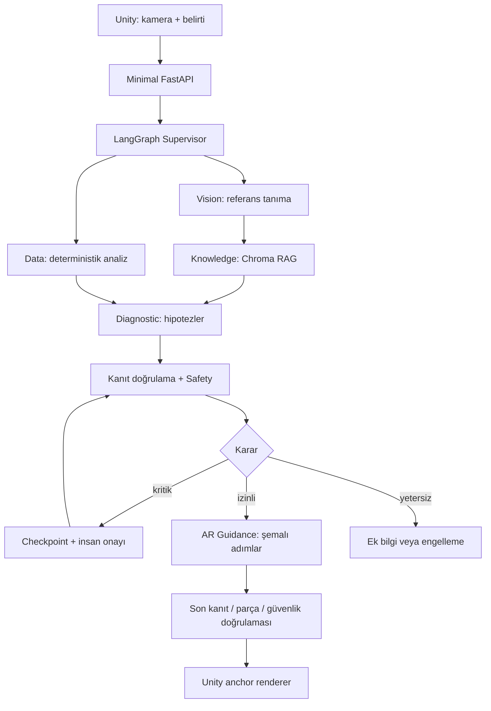

# Mimari kararlar

## Hedef akış (henüz uygulanmadı)

## Modül sınırları

Supervisor yönlendirme ve sınırlı yeniden denemeden sorumlu. Vision ve Data mümkün olduğunca deterministik; uzman ajan sayısı ayrı LLM sayısı demek değildir. Knowledge yalnızca izinli korpusu sorgular. Diagnostic hipotez üretir, müdahale yetkisi vermez. Safety ve kanıt doğrulama geçilemeyen bir kapıdır. AR Guidance yalnızca izinli parça ve talimat kataloğunu kullanır. İlk sürümde tek backend süreci; mikroservis veya ayrı ajan sunucuları yoktur.

## Veri sözleşmeleri (Evidence/Observation uygulandı; diğerleri planlandı)

`AnalysisState`: schema_version, request_id, equipment_id, identity_status, symptom_codes, observations, evidence, hypotheses, safety_decision, guidance, errors, trace. Ham görüntü checkpoint içine gömülmez.

`Evidence`: schema_version, evidence_id, document_id, document_version, checksum, page, section, excerpt, equipment_id, retrieval_score. En az page veya section gerekir. Retrieval skoru doğruluk olasılığı değildir.

`Observation`: schema_version, equipment_id, sensor_id, timestamp_utc, quantity, value, unit, provenance (`simulated`/`measured`), quality. Zaman sırası, boş veri ve birim doğrulanır.

`Hypothesis`: code, explanation, supporting_evidence_ids, contradicting_evidence_ids, missing_information, uncertainty. Tanımlı bir kalibrasyon olmadan yüzde kesinlik sunulmaz.

`GuidanceStep`: step_id, part_id, instruction_id, evidence_ids, risk, approval_reference, tracking_required. Serbest dünya koordinatı veya yeni bakım komutu üretilemez.

`SafetyDecision`: allowed / needs_information / needs_approval / blocked; reason_codes ve kanıt kimlikleri. Bilinmeyen risk ve doğrulama hatası engellemeye gider.

## API taslağı

İleride `POST /v1/analyses`, `GET /v1/analyses/{id}` ve `POST /v1/analyses/{id}/approval`. Bu genel analyses uç noktaları henüz yok. Uygulanan yerel sentetik endpointler /v1/demo altında değerlendirme, sensör, Diagnostic ve yetkili inceleme işlemleridir; ayrıca /health, /ready ve /demo vardır. Ayrıntılı mevcut sözleşmeler docs/API.md içinde. İstekler sürümlü ve boyut sınırlı olacak; tekrar gönderimde request_id ile idempotency korunacak. Unity DTO'ları Python sözleşmesi fixture'larıyla kontrol edilecek. Telefon için localhost yerine geliştirme makinesinin erişilebilir adresi gerekir; dağıtım öncesi kimlik doğrulama/TLS tasarlanır.

## İnsan onayı ve hata davranışı

LangGraph checkpoint deposu kalıcı run kimliğiyle kullanılacak. Onay yetkili kullanıcı, tam adım ve kanıt sürümüyle bağlanır; süreli ve sunucu tarafında doğrulanır. Kanıt/adım değişirse onay geçersizdir. Onay yasak bir işlemi izinli hale getirmez. Resume sonrası Safety tekrar çalışır. Döngülerde adım ve zaman sınırı olur. Kaynak çelişkisi, zaman aşımı, belirsiz kimlik ve düşük güven durumunda rehberlik üretilmez; açık eksik bilgi döner.

## Riskler ve kararlar

| Risk | Karar / doğrulama |
|---|---|
| Yanlış ekipman | Tek aile, kimlik eşleşmesi, bilinmeyen test seti |
| LLM uydurması / doküman prompt injection | Kanıt kimliği doğrulama, araç sınırı, izinli talimat kataloğu |
| Yanlış sayfa / çelişkili sürüm | Sürüm ve checksum; çelişkide durma |
| Düşük voltajın güvenli varsayılması | Üretici sınırları ve laboratuvar incelemesi; hareketli/sıcak parçalar kapsam değerlendirmesinde |
| AR kayması | Önceden ölçülmüş anchor; takip kaybında gizleme |
| Simülasyonun gerçek sanılması | Her gözlem ve sonuçta provenance |
| Windows / native paket uyumsuzluğu | Python 3.12, izole venv, ayrı opsiyonel bağımlılıklar |
| iOS geliştirme erişimi | Unity haftasından önce Mac/Xcode ve cihaz erişimini doğrula |
| Bütçe/gecikme | Çağrı sayısı sınırı, token/latency kaydı; model seçimi deneyle |

## Dizin kararı

Python kaynakları `ai-engine/holoassist/` altında namespaced paket olur; `agents`, `vision`, `rag`, `analytics`, `safety`, `api`, `contracts` bu paketin altındadır. Testler `ai-engine/tests` içinde. `unity-app` Editor kurulumu öncesi yalnızca yer tutucudur; sahte manifest/Editor sürümü oluşturulmaz.

## T06 uygulama notu
AnalysisRequest ve AnalysisState contracts/analysis.py altında uygulanmıştır. Giriş alanları state içinde request altında gruplanır; sonuçlar evidence/status/missing_information/errors/trace alanlarında tutulur. RecognitionResult OpenCV importu gerektirmeyen contracts/recognition.py altında paylaşılır. Supervisor → kaynak arama adapterı → metadata doğrulama akışı LangGraph ile çalışır; Diagnostic, Safety, kalıcı onay ve AR düğümleri henüz bağlı değildir. Ayrıntılar docs/ORCHESTRATION.md içinde.

## T07 sentetik Diagnostic notu
contracts/diagnostic.py ve agents/diagnostic.py mevcut AnalysisState üzerinde bağımsız, deterministik katalog değerlendirmesi sağlar. Destek/karşıt kaynaklar tam alıntı ve belge konumuyla bağlanır. T06 grafı değiştirilmedi; LLM ve Diagnostic graf entegrasyonu bekliyor. Bu prototip gerçek mod için katalog kabul etmez. Detaylar docs/DIAGNOSTIC.md içinde.

## T08 veri analizi notu
analytics/series.py ve contracts/analytics.py bağımsız seri istatistikleri, zaman bazlı doğrusal eğim ve MAD aykırı adaylarını uygular. Standart kütüphane kullanılır; yeni bağımlılık eklenmedi. Kalite sorunu/eksik örneklerde durur, provenance korunur. Data/graf/Diagnostic entegrasyonu bekliyor. docs/ANALYTICS.md hesaplama ve yorumlama sınırlarını açıklar.

## T09 gösterim kapısı notu
safety/gate.py kaynak/katalog/ekipman/parça/takip durumunu kontrol eden bağımsız sentetik plan kapısıdır. Kritik adım needs_approval döndürür; yasak/bilinmeyen risk bloke edilir. Uygunsuz planda metin ve alıntılar atomik gizlenir. Fiziksel bakım izni, kalıcı onay veya tam ajan entegrasyonu uygulanmadı. docs/SAFETY.md güven sınırını açıklar.

## T10 uygulama checkpoint'i notu
safety/approvals.py SQLite içinde normalize analiz/request/katalog snapshot'ı, onay kaydı ve audit tutar. Tüketim atomiktir; onay süresi, mevcut reviewer izin listesi ve yeniden çalışan T09 kapısı kontrol edilir. Resume çıktısı yalnızca sentetik tek kullanım receipt'idir; LangGraph checkpointer/interrupt-resume ve fiziksel bakım yetkisi henüz bağlanmadı. docs/APPROVALS.md kimlik/dosya güven sınırlarını açıklar.

## PostgreSQL ve Compose kararı
Onay/snapshot/audit kayıtları PostgreSQL backend'iyle de saklanabilir. SQLite yerel test seçeneğidir; teknik doküman araması Chroma'da kalır. Compose şu anda yalnızca PostgreSQL servisidir; API/Python konteyneri henüz yok. Ortak onay yaşam döngüsü transaction-scoped advisory lock ile korunur. docs/POSTGRES_DOCKER.md kurulum ve doğrulama sınırlarını açıklar.

Donanım hazırlığı: contracts/equipment.py ve holoassist.equipment CLI sürümlü metadata/eksik bilgi raporu sağlar. Bu veri gerçek cihazı doğrulamaz, operasyonel limit tanımlamaz ve onay akışına yetki eklemez. Motor henüz seçilmedi; docs/EQUIPMENT_INTAKE.md.
