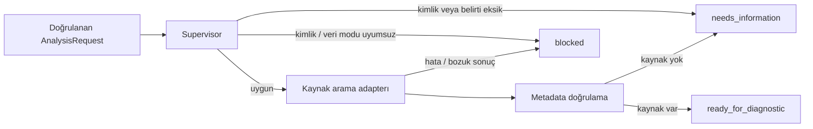

# T06 — AnalysisState ve sınırlı Supervisor

21 Ekim 2026: Gerçek LangGraph üzerinde üç düğümlü orkestrasyon prototipi eklendi. Bu adım tam çok ajanlı teşhis, Safety Agent veya bakım rehberliği değildir.

## Çalıştırma

```powershell
.\.venv\Scripts\python.exe -m pip install -e '.[dev,rag,vision,orchestration]'
.\.venv\Scripts\python.exe -m holoassist.rag.search --db data/demo-chroma --source-kind synthetic index datasets/fixtures/synthetic-guide.json
.\.venv\Scripts\python.exe -m holoassist.agents --request datasets/fixtures/analysis-request.json --db data/demo-chroma
.\scripts\check.ps1
```

Beklenen sonuç: `ready_for_diagnostic`, `guidance_allowed=false`, kaynaklı parçalar ve üç adımlı trace. Gerçek CLI çıktısı `docs/examples/supervisor-result.json` içinde. Fixture tamamen sentetiktir; içindeki matched tanıma kaydı fiziksel bir motor ölçümü değildir. Gerçek Vision → Chroma → LangGraph bağlantısı ayrıca entegrasyon testinde sentetik görüntülerle çalıştırılır.

## Akış



Graf döngüsüzdür; en fazla üç düğüm ve bir retrieval çağrısı çalışır. Otomatik retry, checkpoint ve resume yoktur. Recursion limit 6'dır. Bu sınır düğüm sayısını sınırlar; harici adapter çağrısı için süre aşımı sağlamaz. Uzak adapter kullanılmadan önce timeout/cancellation ayrıca uygulanmalıdır.

## Sözleşmeler

- `AnalysisRequest`: schema_version, request_id, equipment_id, açık demo/real modu, RecognitionResult, belirtiler ve isteğe bağlı ObservationSeries. Desteklenen belirtiler: overheating, not_rotating, unusual_vibration. Tekrarlanan/bilinmeyen belirtiler ve ek alanlar reddedilir.
- `AnalysisState`: request, status, en fazla üç kaynak parçası, eksik bilgiler, yapılandırılmış hata kodları, sıralı trace ve sabit false rehberlik izni. Request üzerinden evidence, status, approval veya trace enjekte edilemez; her çalıştırmada yeni state oluşturulur.
- `RecognitionResult`, OpenCV bağımlılığı olmadan paylaşılabilmesi için `contracts/recognition.py` altına taşındı. Eski `vision.reference` import yolu korunur. Negatif eşleşme sayıları, inlier>match ve sonlu olmayan köşeler reddedilir.
- Her düğüm geçişinde tüm state yeniden doğrulanır. Kanıtlar tam DocumentChunk metadata'sıyla taşınır; aynı equipment_id ve beklenen kaynak türü gerekir. Tekrarlanan kanıt kimlikleri ve aynı belgenin çelişen sürüm/checksum kayıtları reddedilir.

## Durma kuralları

Eksik/unknown/low_confidence tanıma ve eksik belirtiler ek bilgi ister. Ekipman kimliği uyuşmazlığı veya demo/real referans uyumsuzluğu bloke edilir. Demo yalnızca synthetic referans/kaynak ve varsa simulated sensör verisi kabul eder; real modu real referans/manufacturer kaynak ve varsa measured veri gerektirir. Farklı ekipmanın veya suspect/invalid kaliteli sensör verisiyle ilerlenmez.

Kaynak aramasında exception, bozuk çıktı, yanlış ekipman/kaynak türü ve çelişen revizyonlar bloke edilir. Kaynak bulunamazsa needs_information döner. Hata ayrıntıları, dosya yolları ve güvenilmeyen payload trace/CLI hata çıktısına kopyalanmaz; yalnızca kodlar döner. Belge alıntıları state içinde veri olarak tutulur; araç talimatı olarak yürütülmez. Sorgu terimleri sabit belirti eşlemesinden üretilir.

## Güven sınırı ve kapsam

`ready_for_diagnostic`, yalnızca bir sonraki teşhis modülüne aktarılabilecek yapılandırılmış bağlamın hazır olduğunu belirtir. Kaynakların gerçekliğini, alıntının teknik iddiayı desteklediğini veya ekipmanın güvenli olduğunu kanıtlamaz. Rehberlik izni bu prototipte her zaman kapalıdır. Kaynak çelişkisi kontrolü sürüm/checksum düzeyindedir; belgeler arası anlamsal çelişki henüz incelenmez.

Yerel `run_analysis` adapter API'si kimlik doğrulama veya donanım tanıma kanıtı değildir. İstemcinin gönderdiği `matched`, real veya measured beyanı fiziksel doğruluk sağlamaz. Ağ API'sine geçerken bu sonuçlar backend'in güvendiği adapterlardan üretilmeli; kullanıcıdan gelen onay alanları yetki olarak kullanılmamalıdır. request_id henüz idempotency veya kalıcı çalışma kimliği sağlamaz.

Diagnostic/Data/Safety/AR Guidance ajanları, LLM çağrısı, kalıcı onay ve Unity entegrasyonu henüz yoktur. Bu adım yalnızca yönlendirme ve bağlam doğrulamasıdır.

## Ortam ve testler

LangGraph 1.2.16 `orchestration` extra grubuyla kuruldu. `ai` extra grubu artık gelecekteki OpenAI istemcisini içerir; LangGraph kullanmak için orchestration grubunu seçin. Doğrulanan dev+rag+vision+orchestration paketleri `requirements-orchestration.lock.txt` içinde kayıtlı. Tüm gelecek extras resolver raporu `docs/dependency-resolution.json` dosyasında güncellenir.

Testler: geçerli handoff, erken durma, kaynak adapterı hata/bozuk çıktı, veri kaynağı ayrımı, sensör kalitesi, çelişen sürüm, state enjeksiyonu, trace izolasyonu, hata çıktısında payload gizleme ve gerçek Vision/Chroma/LangGraph entegrasyonu. Ağ ve LLM birim testlerinde kullanılmaz. Tam kontrol sonucu `docs/STATUS.md` içinde.

Uygulama kaynağı: [LangGraph Graph API](https://docs.langchain.com/oss/python/langgraph/graph-api).
