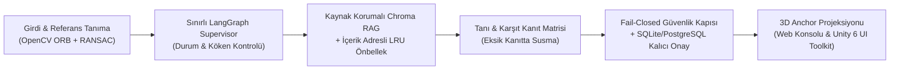

# Jüri, Staj Görüşmesi ve Portföy Teknik Savunma Rehberi

Bu belge, **HoloAssist AI** projesinin mühendislik kararlarını, güvenlik sınırlarını, tekrarlanabilir sentetik benchmark sonuçlarını ve canlı demo akışını sunmak için hazırlanmıştır.

> **Dürüst Kapsam İlkesi (`AGENTS.md`):** Mevcut sistem, düşük voltajlı DC motor eğitim düzeneği (`synthetic-rig`) için tasarlanmış **kanıta dayalı teknik analiz, güvenlik kapısı ve 3D sentetik denetim istasyonu** prototipidir. Fiziksel motor (`T01`) ve mobil kamera/ARKit saha ölçümleri (`T13`) tamamlanmadan saha başarısı iddia edilmez; `guidance_allowed` tüm sözleşmelerde `false` olarak kilitlidir.

---

## 1. Projenin Mühendislik Farkı (Neden Sıradan Bir "Kamera + LLM" Uygulaması Değil?)

Tipik başlangıç projeleri bir kamera karesini ve kullanıcı sorusunu doğrudan LLM'e gönderip kaynaksız metin üretir. Endüstriyel bakımda bu yaklaşım **halüsinasyon, tek taraflı doğrulama yanlılığı ve tehlikeli müdahale** riski taşır.

HoloAssist AI bunun yerine **5 deterministik doğrulama katmanı** uygular:



1. **Kaynak Kilidi (`Evidence` & `SafetyCitation`):** Sayfa/bölüm, doküman sürümü, `evidence_id` ve orijinal bayt `SHA-256` özeti olmayan hiçbir adım `display_allowed` alamaz.
2. **Karşıt Kanıt ve Susma (`Abstention`):** Tanı kataloğundaki karşıt doküman kaydı (`contradicts`) eksikse sistem tek taraflı hipotez üretmez; tüm olasılıkları gizler (`hypotheses: []`).
3. **Atomik Gizleme (`Atomic Redaction`):** Çok adımlı bir planda tek bir adım bile `needs_approval` veya `blocked` ise tüm planın `display_text` ve `quote` alanları atomik olarak `null` yapılır.
4. **Kalıcı İnsan Onayı ve Replay Koruması:** İstemcinin gönderdiği `"approval"` alanı `HTTP 422` ile reddedilir (`extra="forbid"`). Onay yalnızca sunucu tarafında `context_digest` eşleşmesi ve tek-kullanımlık (`consumed`) kayıtla işlenir.
5. **Uzamsal 3D Anchor Kapısı (`T14`):** `tracking_status != "tracked"` veya katalog dışı `part_id` geldiği anda hem Web şemasında hem Unity 6 3D sahnesinde aktif parça vurgusu ve ok/kart izdüşümü anında temizlenir.

---

## 2. Tekrarlanabilir Sentetik Benchmark Sonuçları (`T15`)

Aşağıdaki sonuçlar dondurulmuş sentetik veri setleri üzerinde dış ağ veya API anahtarı gerektirmeden tek komutla yeniden üretilebilir:

```powershell
.\.venv\Scripts\python.exe -m holoassist.evaluation --output docs/examples/synthetic-benchmark-report.json
```

| Alt Sistem | Kapsam | Doğrulanan Metrik (`synthetic_fixture_benchmark`) |
|---|---|---|
| **Görüntü İşleme (`T05`)** | 4 sentetik kare (referans, perspektif, yabancı desen, boş) | Sentetik Precision `1.0`, Recall `1.0`, F1 `1.0`, perspektif köşe sapması `~7.45 px` (`calibrated_probabilities: false`) |
| **RAG + LRU Önbellek (`T04`, Hafta 11)** | 3 sentetik belge, 5 parça, 5 sorgu | Kaynak konum tamlığı `%100`, ekipmanlar arası sızıntı `0`, önbellek `2 hit / 3 miss` (soğuk sorguya göre belirgin hızlanma) |
| **Supervisor & Tanı (`T06–T08`)** | 3 `simulated` sensör serisi + tanı kataloğu | LangGraph `ready_for_diagnostic` devri, sayfa 4 karşıt kanıt korunumu ve eksik karşıt kanıtta susma doğrulandı |
| **Güvenlik, Onay & 3D Anchor (`T09–T10`, `T14`)** | 8 düşmanca (adversarial) senaryo | Güvenlik ihlali `0 / 8`; takip kaybı bastırma, bilinmeyen parça reddi, SQLite özet kurcalama ve replay reddi geçti |

---

## 3. Canlı Jüri / Mülakat Demo Akışı (3 Dakika)

1. **Sunucuyu Başlatın:**
   ```powershell
   .\.venv\Scripts\python.exe -m uvicorn holoassist.api.app:local_review_app --factory --host 127.0.0.1 --port 8001
   ```
2. **Kurumsal Mimari ve API Kum Havuzu (`http://127.0.0.1:8001/`):**
   - Katmanlı güvenlik mimarisini ve `01 Güvenlik` → `04 Sentetik Benchmark` sekmelerini canlı gösterin.
3. **Teknik İnceleme Konsolu (`http://127.0.0.1:8001/demo`) & Unity 6 UI Toolkit İstasyonu (`unity-app`):**
   - İki ekranı yan yana açın.
   - **Senaryo 1 (`information`):** Kaynaklı bilgi kartının ve `anchor-demo-label` `(0.0, 0.64, 0.0)` 3D vurgusunun açıldığını gösterin.
   - **Senaryo 2 (`critical`):** Kritik adımda metnin atomik gizlendiğini, yalnızca `needs_approval` uyarısının döndüğünü gösterin.
   - **Senaryo 3 (`tracking: lost`) & Senaryo 5 (`HTTP 422 injection`):** Takip kaybında 3D vurgunun silindiğini ve istemci `approval` enjeksiyonunun sınırda reddedildiğini kanıtlayın.
   - **Bölüm 05 (`Benchmark`) & `04 Bench` Sekmesi:** Tekrarlanabilir sentetik benchmark raporunu hem Web hem Unity üzerinde canlı çalıştırın.

---

## 4. Açık Donanım Kapıları ve Gelecek Çalışmalar

- **`T01` — Fiziksel DC Motor ve Lisanslı Üretici Kılavuzu:** Gerçek düşük voltajlı DC motor eğitim düzeneğinin seçilmesi, telif/yeniden dağıtım izinli kılavuzun indekslenmesi ve gerçek çalışma sınırlarının girilmesi.
- **`T13` — Fiziksel Mobil Kamera ve ARKit/ARCore Saha Ölçümleri:** Gerçek ışık/açı değişimlerinde milimetre/piksel hizalama hatası ve takip geri kazanım süresinin ölçülmesi.
- **Tek Ajan vs. Çok Ajan Canlı LLM Deneyi:** İzinli üretici dokümanı eklendikten sonra sabit bütçe altında tek ajanlı ve çok ajanlı LLM kurgularının doğruluk ve p50/p95 gecikme karşılaştırması.

